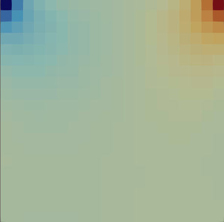
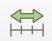
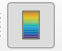
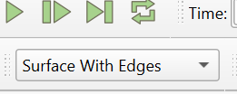
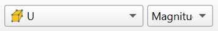
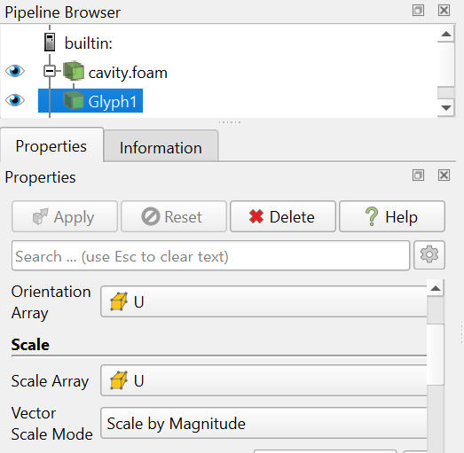

# Install ParaView in Windows

These steps install ParaView directly in Windows, for viewing OpenFOAM cases run in Ubuntu (WSL) as set up in [01_Install_OpenFOAM-v2606_WSL.md](01_Install_OpenFOAM-v2606_WSL.md). ParaView needs about 2 GB of free disk space.

The official download page is [www.paraview.org/download](https://www.paraview.org/download/).

Feel free to try this out: the end of this document explains how to remove ParaView again.

## Step 1: Install ParaView

1. Go to [www.paraview.org/download](https://www.paraview.org/download/), select *Windows*, and download the latest `.msi` (not `.zip`) installer without `MPI` in its name, e.g. `ParaView-6.2.0-Windows-Python3.12-msvc2017-AMD64.msi`.
2. Run the downloaded file and accept the default settings.

## Step 2: Test the installation

1. In the **Ubuntu** terminal, prepare the cavity case that was run when testing OpenFOAM (in [01_Install_OpenFOAM-v2606_WSL.md](01_Install_OpenFOAM-v2606_WSL.md)):

   ```
   cd $FOAM_RUN/cavity
   touch cavity.foam
   ```

2. Preparation (only once): In Windows Explorer, browse to the OpenFOAM `run` directory by clicking on the penguin at the bottom of the folder browser (typically in `Ubuntu\home\<username>\OpenFOAM\<username>-v2606\run`, where `<username>` is your Ubuntu username). Right-click on the address bar and click *Copy address as text*.
3. Start ParaView from the Windows Start menu. Click *File > Open*. Paste the address to the OpenFOAM `run` directory at `Look in:` and press Enter. It should be something like `\\wsl.localhost\Ubuntu\home\<username>\OpenFOAM\<username>-v2606\run`.
4. Add the OpenFOAM `run` directory to *Favorites*, so you will find it easily later, by clicking the button for adding the current directory to *Favorites* (in the panel on the left). Next time, click the run directory there. A case you have opened before is also found under *File > Recent Files*.
5. Open the `cavity` directory, select `cavity.foam`, and click *OK*.
6. In the *Properties* panel, tick *Create cell-to-point filtered data* (it is not ticked by default in ParaView 6.2). ParaView then also shows the values interpolated to the mesh points. Click *Apply*. The installation works if you see the following in the main ParaView visualization window:

   

## Step 3: Basic use of ParaView for the cavity case

Thorough ParaView tutorials are available at [www.paraview.org/tutorials](https://www.paraview.org/tutorials/). Below are some examples.

1. **Set the view.**:

   Rotate with the left mouse button, move with the middle button, and zoom with the mouse wheel.
   
   Click *Set view direction to -Z* in the toolbar:

   
.
2. **Colour by pressure.**
   
   In the toolbar, change the colouring from *Solid Color* to **p**:

   
3. **Go to the last time.**
   
   Use the time controls in the toolbar and click *Last Frame*.

   
   
   The time field shows 0.5.
4. **Rescale the colours.**
   
   Click *Rescale to Data Range*.
   
   
   
   The colour range is otherwise kept from the first time shown. 
   
   Click *Toggle Color Legend Visibility* to show the colour bar.
   
   
5. **Show the mesh.**
   
   Change the representation from *Surface* to *Surface With Edges*:

   
6. **Colour by velocity.**
   Change the colouring from **p** to **U**.
   
   
   
   *Magnitude* shows the speed.
7. **Show velocity vectors.**
   Select *Filters > Common > Glyph*.
   
   

   Click on Glyph1 in the Pipeline Browser to mark it. In *Properties*, set *Orientation Array* to **U** and *Scale Array* to **U**, then click *Apply*.
   
   

   You might have to hide the cavity.foam object in the Pipeline Browser by clicking on the eye to the left of it in order to see the vectors.

Nothing is changed until you click *Apply*. After running the case again, use *File > Reload Files*.

## Remove ParaView

Open *Settings > Apps > Installed apps*, find *ParaView*, and select *Uninstall*.

ParaView also keeps its settings in the folder `%APPDATA%\ParaView`. You can delete it too.

## Next

Now you can continue with [03_Linux_tutorial.md](03_Linux_tutorial.md).

If you already know Linux, you can skip directly to [04_The_OpenFOAM_flange_tutorial.md](04_The_OpenFOAM_flange_tutorial.md).
